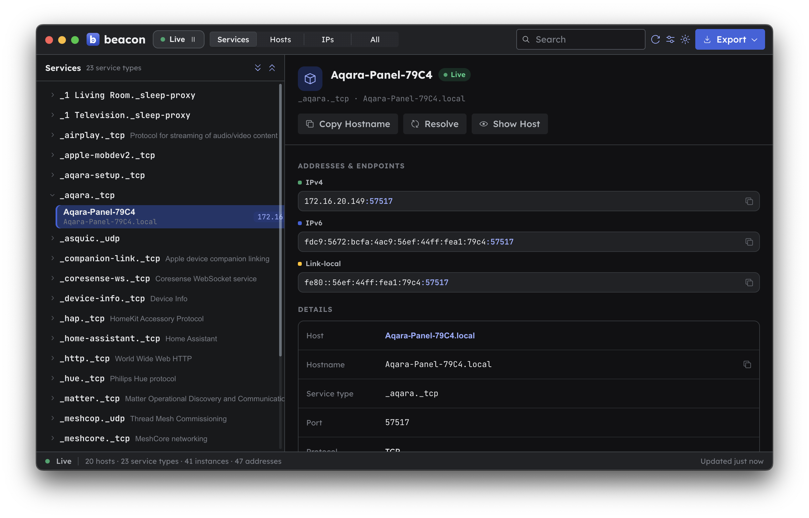

# Beacon

A desktop app for browsing **mDNS / Bonjour / DNS-SD** services on your local
network. Watch devices and services appear and disappear in real time.

Built with Electron, React, Radix Themes, and [`bonjour-service`](https://www.npmjs.com/package/bonjour-service).



## Vibe Coded

This app is mostly built with the assistance of Claude and other LLM tools. It works for me. But expect rough edges and treat it as a hobby project. Consider this your AI warning.

## Install

**macOS (Homebrew):**

```sh
brew tap andyshinn/beacon https://github.com/andyshinn/beacon
brew install --cask beacon
```

Later, `brew upgrade --cask beacon`. (The explicit repo URL is needed because the
cask lives in this repo rather than a separate `homebrew-beacon` tap.)

**Other platforms:** grab the installer for your OS from the
[latest release](https://github.com/andyshinn/beacon/releases/latest) — `.dmg`
(macOS), `Setup.exe` (Windows), or `.deb` / `.rpm` (Linux).

## Development

```sh
pnpm install
pnpm start      # run the app in dev
pnpm test       # run the test suite
pnpm make       # build distributables
```

## License

MIT
